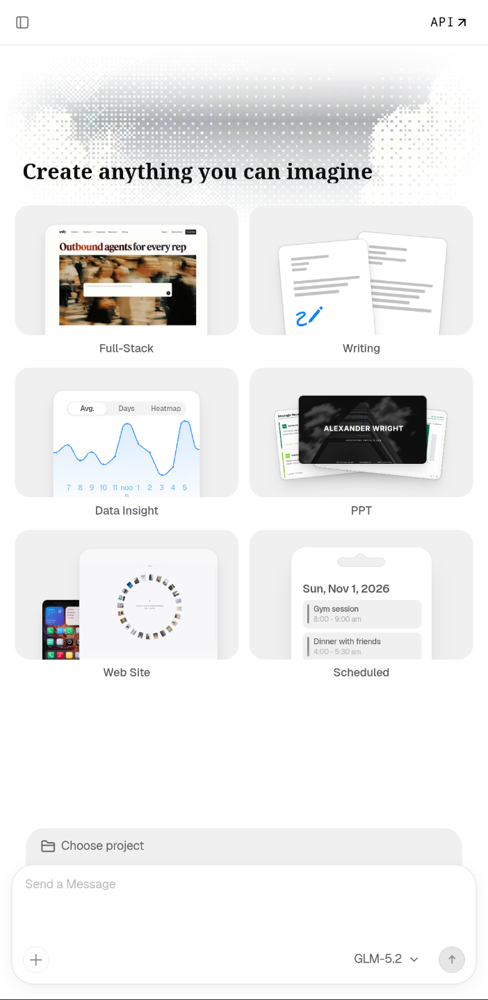
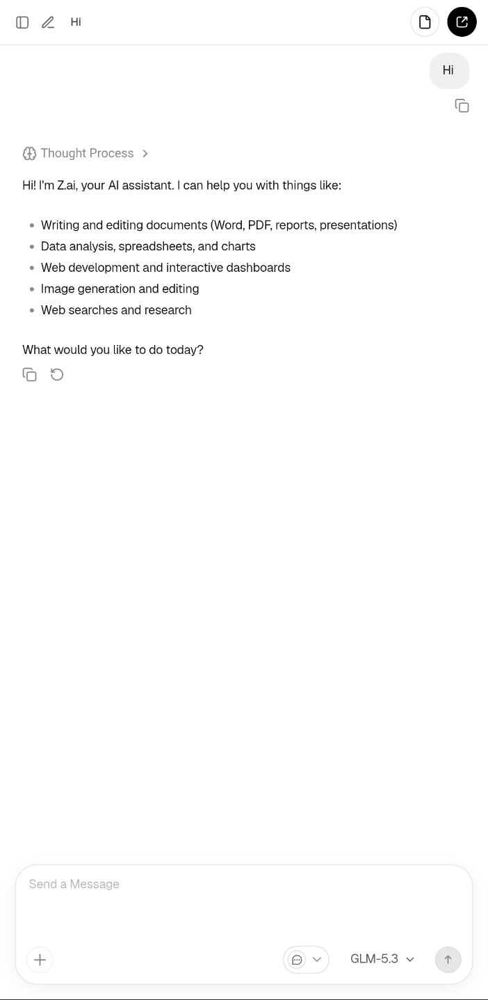
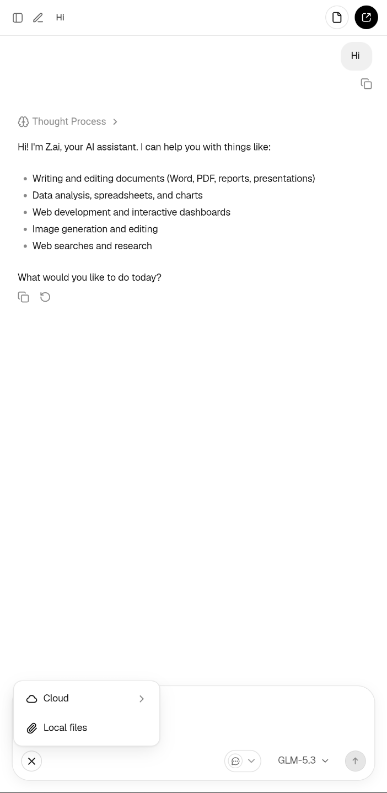

<div align="center">


<br>

[](https://github.com/BlazeFTL/GLM-Assist/releases/latest)
[](https://github.com/BlazeFTL/GLM-Assist/releases)
[](https://github.com/BlazeFTL/GLM-Assist/actions)
[](#requirements)
[](LICENSE)

### [Download the latest APK](https://github.com/BlazeFTL/GLM-Assist/releases/latest)

</div>

---

## About

GLM-Assist wraps [chat.z.ai](https://chat.z.ai/) in a lightweight, no-frills Android app. It opens the GLM web app full screen and adds the native bits a browser tab does not give you: reliable file uploads, working downloads, and voice and camera access.

The APK is about 50 KB. No ads, no trackers, no extra dependencies beyond `androidx.webkit`.

## Screenshots

<div align="center">

&nbsp;

&nbsp;

</div>

## Features

| | |
|---|---|
| **Plain WebView** | Loads the real site. No URL blocking or content rewriting. |
| **File upload** | Pick one or many files from the system picker. |
| **Voice and camera** | Microphone and camera permissions are requested on demand. |
| **Smart downloads** | Handles regular, `blob:` and `data:` URLs. Files land in Downloads. |
| **Image saving** | Long press any image to save it. |
| **Persistent login** | Cookies and DOM storage are kept between launches. |
| **Light and dark** | Follows the system theme. |
| **Tiny footprint** | Minified and resource-shrunk release build. |

## Install

1. Open the [latest release](https://github.com/BlazeFTL/GLM-Assist/releases/latest).
2. Download `GLM-Assist_V<version>.apk`, for example `GLM-Assist_V1.0.apk`.
3. Open it and allow installs from your browser or file manager if asked.

Each release lists the SHA-256 of the APK so you can verify the download.

## Requirements

- Android 8.0 (API 26) or newer
- Android System WebView or Chrome, kept up to date

## Permissions

| Permission | Why |
|---|---|
| `INTERNET` | Load chat.z.ai |
| `RECORD_AUDIO` | Voice input |
| `CAMERA` | Photo and camera upload |
| `MODIFY_AUDIO_SETTINGS` | Audio routing during voice input |
| `WRITE_EXTERNAL_STORAGE` | Downloads on Android 9 and older only |

## Build

```bash
git clone https://github.com/BlazeFTL/GLM-Assist.git
cd GLM-Assist
./gradlew assembleRelease
```

Output: `app/build/outputs/apk/release/app-release.apk`

Override the version locally:

```bash
./gradlew assembleRelease -PappVersionName=1.1 -PappVersionCode=2
```

Requires JDK 17.

## Releases and versioning

Releases are built by GitHub Actions.

| Trigger | Version | Release |
|---|---|---|
| Push to `main` | `1.0` | Replaces the `v1.0` release |
| Manual run | Your input, for example `1.1` | Optional, on by default |

To publish a new version:

1. Open **Actions** and select **Build APK**.
2. Tap **Run workflow**.
3. Enter a version such as `1.1` or `1.2`.
4. Keep **Publish GitHub release** on to create the release, or turn it off to get the APK as a build artifact only.

The tag, release title and in-app `versionName` all use the version you enter. `versionCode` is the run number, so every build installs as an update over the previous one.

## Credits

Based on geminiAssist (GPLv3), which is based on gptAssist and GMaps WV.

## License

Licensed under the [GNU GPL v3.0](LICENSE).

<div align="center">
<sub>Not affiliated with Z.ai or Zhipu AI.</sub>
</div>
